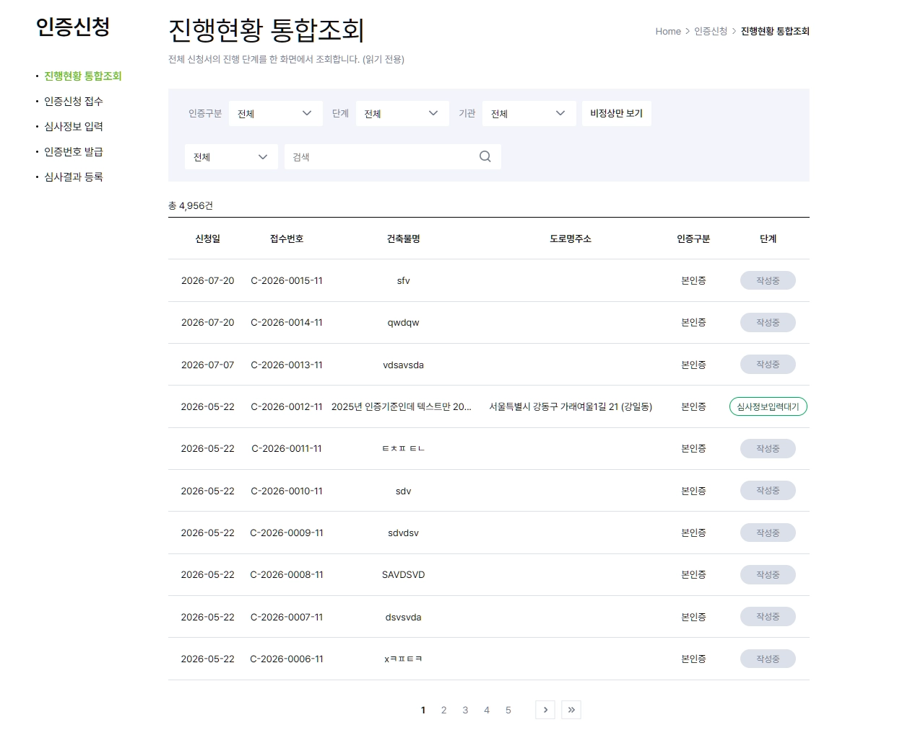
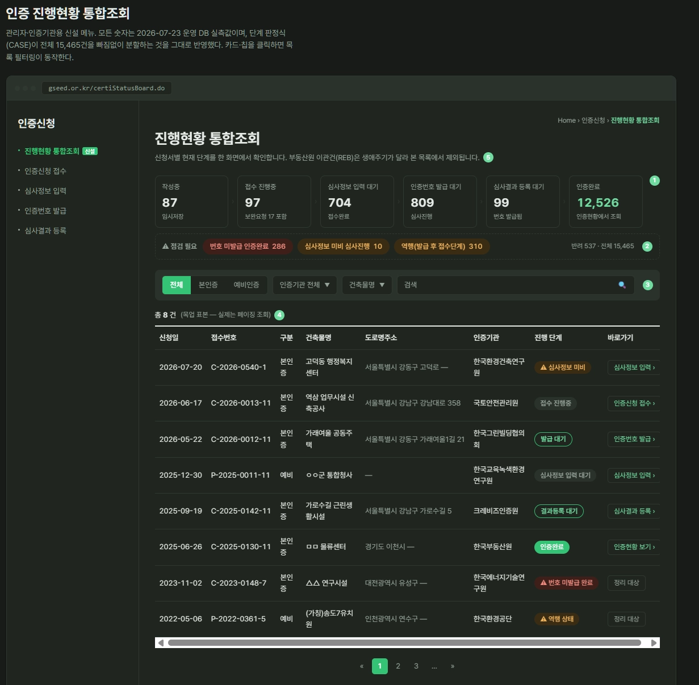

<div align="center">

# gx-design

**BX · 그래픽 · UX/UI · 영상 — Claude Code와 Codex에서 한 줄로 요청하세요.**

AI 크리에이티브 디렉터가 결정 트리가 빌 때까지 인터뷰하고,
리서치 → 전략 → 제작 → 검수 → 실물 제작 파이프라인을 역할별 절차로 진행합니다. 위임 도구가 있고 허용되면 역할을 맡기고, 없으면 주 에이전트가 같은 절차를 수행합니다.

[](https://bs-koo.github.io/gx-design/)

[빠른 시작](#빠른-시작) • [왜 gx-design인가?](#왜-gx-design인가) • [어떻게 작동하나?](#어떻게-작동하나) • [이렇게 시키세요](#이렇게-시키세요) • [구성](#구성) • [FAQ](#faq)

</div>

---

## 빠른 시작

Claude Code에서 설치:

```
/plugin marketplace add bs-koo/gx-design
/plugin install gx-design@gx-design
```

Claude Code를 재시작한 뒤 슬래시 명령이나 자연어로 요청합니다.

```
/gx-design:gx-design 대학생 캠퍼스 중고거래 서비스 UX/UI
/gx-design:gx-redesign 커머스 앱 홈·상세 화면 리뉴얼
```

Codex에서 원격 마켓플레이스를 등록하고 설치:

```powershell
codex plugin marketplace add bs-koo/gx-design
codex plugin add gx-design@gx-design
```

새 Codex 대화에서 `$gx-design 대학생 캠퍼스 중고거래 서비스 UX/UI` 또는 `$gx-redesign 커머스 앱 화면 개선`처럼 요청합니다. `$` 호출이 안정적인 진입 방법입니다. 설치·스킬 수정·재설치 검증은 [두 호스트 유지보수 안내](docs/codex-skill-maintenance.md)를 따릅니다.

Codex 호출 예:

```text
$gx-design 의류 쇼핑몰 가을 신상 랜딩
$gx-redesign 지금 페이지 애니메이션만 점검해줘
```

실제 화면 점검에는 URL 또는 화면 파일이 필요하며, 브라우저 실행 검증은 현재 제공된 브라우저 도구나 기존 Playwright 실행 환경 등 실제 관측 수단이 있을 때 수행합니다.

슬래시 커맨드 없이 자연어로 "○○ 브랜드 만들어줘", "○○ 화면 리뉴얼하고 싶어"라고 해도 신규 제작/기존 개선을 판별해 해당 워크플로가 자동으로 시작됩니다.

## 왜 gx-design인가?

목표·타깃·핵심 과업을 먼저 이해하고, 프로젝트에서 확인되는 사실과 이미 받은 답은 재사용합니다. 결과를 바꾸는 미확정 의도는 필요한 만큼 묻고 답변을 기다립니다. 간격 같은 구현 세부를 전부 사용자 질문으로 돌리지 않습니다.

BX·그래픽·UI·영상은 공통 브리프·브랜드·증거 기준을 사용하면서 요청에 맞는 경로로 진행합니다. 부분 수정에 전체 리서치·전략 3안을 강제하지 않으며, 문서·프롬프트 패키지와 실제 PNG·MP4·실행 UI의 완료 상태를 구분합니다.

전략 일치(축 A), 완성도(축 B), 리디자인 목표 달성(축 C)을 따로 판단합니다. 필수 수용 기준이 미검증이거나 범위 내 Critical·Major가 남으면 해당 범위의 통과를 보류합니다. 마지막 결과물 버전과 관측 조건에 검수 근거를 연결합니다.

## 어떻게 작동하나?

### 신규 제작 (Claude Code: `/gx-design:gx-design`, Codex: `$gx-design`)

```
요청·기존 자료 확인
 → 의도·유지 조건·결과물 형식 확정 — 미정인 필수 결정만 질문
 → 필요한 조사 — 이미 답이 있는 축은 생략
 → 방향 탐색 — 핵심은 추천 1안과 필요한 비교안 1개, 전체·명시 요청은 3안; 확정 방향 재사용
 → 대표 실물·명세 제작 — 요청한 결과물과 기존 스택에 맞게 확장
 → 최종 버전 검수 — 전략·완성도, 필요한 과업·상태·폭 확인
 → 납품 — 통과·예외 수용·미검증·남은 사용자 판단을 구분
```

### 기존 개선 (Claude Code: `/gx-design:gx-redesign`, Codex: `$gx-redesign`)

```
자산 인벤토리 + 목표·보존 범위 확인
 → 읽기 전용 진단 — 위치·증거·영향과 진단 ID
 → 점검만 요청했으면 보고로 완료 — 수정은 새 명시 요청이 있어야 함
 → 수정 요청이면 필요한 조사·방향 확인 후 합의한 범위 제작
 → 변경 ID → before → after → 근거를 진단·목표 ID에 연결
 → 같은 조건 after·회귀 검증 + 최종 버전 A/B/C 검수
```

**실제 적용 사례** — 인증 진행현황 조회 화면의 기존 개선 사례입니다. 현재 버전의 일반적인 품질 효과나 모든 과업의 정답으로 해석하지 않습니다.

| Before | After |
|---|---|
|  |  |

### 진행 모드와 작업 범위

- **전체 모드 / 핵심 모드**는 내부 실행 깊이입니다. 명시한 모드는 존중하고, 미지정이면 핵심 모드로 가볍게 시작합니다. 추가 근거·검토가 필요한 단계만 깊이를 올립니다. 필요한 의도 확인과 필수 품질 기준을 모드 때문에 생략하지 않습니다.
- **점검 전용**은 대상·기기·해당 시 핵심 여정이 정해졌으면 바로 읽기 전용 진단합니다. 미정 항목만 질문하고, 보고 후 종료 선택을 다시 강제하지 않습니다.
- **부분 수정(polish)**은 사용자에게 보인 진단 ID 집합이나 명시한 대상만 수정합니다. `D-02만 고쳐`를 Critical·Major 전체로 확대하지 않습니다.
- **후보 탐색**은 비교 범위가 정해졌으면 대표 후보를 만든 뒤 선택을 기다립니다. 선택 전에 통합·전체 확장을 하지 않습니다.
- **수정 예산**은 기본 총 3회로 제작자 polish와 검수 후 수정을 함께 셉니다. 관찰·판정은 최소 한 번, 수정은 발견 사항이 있을 때 수행합니다. 예산이 끝나도 미달 결과를 통과시키지 않습니다.
- **실행량 기록**은 상세 로그에 위임·외부 열람·렌더·호스트가 제공한 토큰을 남깁니다. 사용자 보고는 상위 결정·변경·남은 문제를 우선합니다. 기준은 [RUN-BUDGET.md](skills/gx-design/RUN-BUDGET.md)를 따릅니다.

### 소요시간을 줄이는 기본 경로

대상과 범위가 명확한 점검·부분 수정은 작업자 하나로 시작하고, 관련 자산과 규칙만 읽습니다. 새 브리프 전문·시장 조사·전략 경쟁·단계별 문서·검수자 분기를 자동으로 만들지 않습니다. 변경되지 않은 지침과 유효한 근거는 같은 세션에서 재사용합니다.

대표 상태 하나부터 보고 관련 위험·요청 기기·필수 과업에 맞춰 확인을 더합니다. 여러 검사는 한 실행에서 묶고 발견한 수정도 함께 처리합니다. 최종 검수 기준과 필수 답변 대기는 유지합니다. 실제 소요시간은 작업 크기·실행 환경에 따라 달라지며 고정 시간이나 속도 향상률을 보장하지 않습니다.

### 브리프 인터뷰는 이렇게 묻습니다

- 요청 해석을 짧게 보여주고 목표·타깃·문제처럼 결과를 바꾸는 미확정 의도부터 확인합니다. 질문 총량의 임의 상한은 없습니다.
- 추천 가능한 대안에는 목표·제약에 근거한 이유와 차이를 설명합니다. 사용자가 알려줘야 할 사실에 근거 없는 추천을 붙이지 않습니다. 자유 응답도 허용합니다.
- 필수 질문을 한 뒤에는 답에 의존하는 제작·수정·위임을 멈춥니다. 기존 자료 확인 등 독립 작업만 진행할 수 있습니다.
- 빈 응답·취소·시간 경과·기본 선택 표시는 승인이 아닙니다. 부분 답변은 답한 항목에만 적용하고 남은 필수 결정을 기다립니다.
- 선택적 선호가 없으면 지정 없음으로 남기고 승인된 기준 안에서 판단할 수 있습니다. 필수 결정 미응답에는 적용하지 않습니다.
- `그만, 진행해`는 현재 범위의 판단 위임입니다. `그만`은 중단입니다. 기존 금지·보존 조건과 외부 실행 권한은 유지합니다.
- 이미 받은 브리프·방향·결과물 제작 승인은 재사용하고, 범위가 바뀌면 영향받는 결정만 다시 확인합니다.

### 선택 제작·관측 도구

[제품 소개 장면](skills/gx-design/PRODUCT-SCENES.md)은 해당 요청에서만 읽습니다. Stageshow의 예제·촬영, Agentation의 위치 피드백, DialKit의 값 비교는 기존 설치와 권한이 있을 때 선택 활용하며 자동 설치·훅을 추가하지 않습니다.

[화면 구조 관측](skills/gx-design/references/OBSERVATION.md)은 자체 작성한 읽기 전용 브라우저 함수와 목록·폼 대조 예제를 제공합니다. 계산 스타일·반복 관계를 요약하며 토큰 정본·기능·접근성 통과를 대신하지 않습니다. Swarm Rebuild 소스는 재사용하지 않았습니다.

## 이렇게 시키세요

한 줄이어도 시작은 됩니다. 다만 아래 다섯 칸을 채울수록 인터뷰가 짧아지고 첫 결과가 덜 뻔해집니다.

```
[무엇을] + [누구·목적] + [뻔한 X 말고 Y처럼] + [기준 자료: DESIGN.md·레퍼런스] + [범위·기기]
```

- 다 채울 필요는 없습니다. 첫 라운드 전에 요청을 이 다섯 칸으로 펼친 **요청 해석 카드**(채운 칸 ✓, 빈 칸 ?)를 보여 주고, 빈 칸 중 지금 정해야 하는 것만 묻습니다. 요청을 다시 써 오라고 돌려보내지 않습니다.
- **"뻔한 X 말고"** 가 가장 효과가 큽니다. 크림+세리프, 다크+형광, AI 보라 그라데이션, 중앙 정렬 히어로처럼 AI가 몰리는 룩을 하나 찍어 두면, 그 칸은 묻지 않고 바로 피합니다.
- 기준 자료가 없으면 [designmd.co](https://www.designmd.co/)나 [awesome-design-md](https://github.com/VoltAgent/awesome-design-md)에서 DESIGN.md를 골라 첨부해도 됩니다.

아래 예시는 Claude Code 슬래시 명령입니다. Codex에서는 앞의 명령만 `$gx-design` / `$gx-redesign`으로 바꾸고 같은 문장을 씁니다.

**1. 신규 UI — 랜딩 페이지**

```
/gx-design:gx-design 사내 협업툴 소개 랜딩 페이지. 도입을 검토하는 IT 팀장이 대상이고 목표는 도입 문의. 뻔한 보라 그라데이션 히어로 말고 실제 제품 화면이 주인공인 절제된 구성으로. 첨부한 DESIGN.md 톤 유지, 데스크톱·모바일 둘 다.
```

Codex: `$gx-design 사내 협업툴 소개 랜딩 페이지. …` — 방향이 열렸다면 전략 스케치를 비교하고, 사용자에게는 정보량·움직임·변경 범위의 차이를 설명합니다.

**2. 점검 전용 — 모션 점검 (전/후/이유 표)**

```
/gx-design:gx-redesign 점검만. 우리 앱 온보딩 화면의 모션이 굼뜨고 어색해. 고치지 말고 문제를 전/후/이유 표로 정리해줘. 대상 http://localhost:3000/onboarding, 모바일 기준.
```

Codex: `$gx-redesign 점검만. 우리 앱 온보딩 화면의 모션이 …` — [MOTION.md](skills/gx-design/MOTION.md) §A 기준으로 진단하고 `요소·위치 | Before(전) | After(후) | Why(이유)` 표로 보고합니다. 점검 보고로 완료하며, 이후 수정은 사용자가 명시한 범위에서만 진행합니다.

**3. 점검 전용 — 모바일 여정 테스트**

```
/gx-design:gx-redesign 점검만. 쇼핑몰 메인 → 상품 상세 → 장바구니 여정을 모바일(375×812)에서 직접 눌러 보고 막히는 곳을 찾아줘. 대상 https://shop.example.com
```

Codex: `$gx-redesign 점검만. 쇼핑몰 메인 → 상품 상세 → 장바구니 여정을 …` — 가용한 브라우저 실행 수단이 있으면 실제로 클릭하며 콘솔 오류까지 실행 검증 로그에 남깁니다. 없으면 설치 방법을 한 번 안내하고, 확인하지 못한 범위는 미검증으로 표시합니다.

**4. BX — 브랜드 아이덴티티**

```
/gx-design:gx-design 동네 베이커리 브랜드 BX. 출근길 30대 직장인 단골 확보가 목적. 뻔한 크림+세리프 감성 말고 갓 구운 빵처럼 따뜻하고 경쾌한 톤으로. 로고·패키지·간판까지.
```

Codex: `$gx-design 동네 베이커리 브랜드 BX. …`

**5. 숏폼 영상 — 모션 그래픽**

```
/gx-design:gx-design 신규 앱 런칭 15초 Instagram Reels. 20대 대상, 목표는 앱 설치. 뻔한 다크+형광 테크 연출 말고 손글씨 키네틱 타이포처럼. 세로 9:16, 30fps.
```

Codex: `$gx-design 신규 앱 런칭 15초 Instagram Reels. …` — 영상은 UI와 다른 규칙(MOTION.md §B)을 씁니다. 씬 길이를 초(프레임)로 검산하고, 텍스트 홀드·전환 체계·플랫폼 안전영역을 명세에 적습니다.

### 디자인 스킬 5개를 따로 설치하지 않아도

"디자인 잘하려면 이 스킬 5개를 깔아라"는 조합의 핵심 규칙을 gx-design 단계 안에 우리 문장으로 재서술해 넣었습니다. 외부 스킬이 없어도 동작하고, Playwright MCP처럼 실행 도구가 필요한 것만 설치돼 있으면 더 정확해집니다.

| 스킬 | gx-design에서 맡는 곳 | 출처 · 라이선스 |
|---|---|---|
| DESIGN.md | 단계 0 디자인 톤 기준 — 팔레트·타이포·톤을 전략부터 검수까지 구속, awesome-design-md 9절 포맷 매핑 ([DESIGN-TONE-ANCHOR.md](skills/gx-design/DESIGN-TONE-ANCHOR.md)) | [VoltAgent/awesome-design-md](https://github.com/VoltAgent/awesome-design-md) · MIT |
| taste | 전략 단계 다이얼 VARIANCE·MOTION·DENSITY 1~10 + 프리미엄 프리셋(선택) ([VISUAL-CRAFT.md](skills/gx-design/VISUAL-CRAFT.md)) | [Leonxlnx/taste-skill](https://github.com/Leonxlnx/taste-skill) (taste-skill-v2-experimental · high-end-visual-design) · MIT |
| impeccable audit·polish | 진단 = audit(읽기 전용), 수정 회차 = polish 패스, detect CLI 선택 실행 ([VISUAL-QUALITY.md](skills/gx-design/VISUAL-QUALITY.md) · [UI-QUALITY.md](skills/gx-design/UI-QUALITY.md)) | [pbakaus/impeccable](https://github.com/pbakaus/impeccable) · Apache-2.0 |
| emil-design-eng | UI 인터랙션 모션 규칙 — 빈도·이징·지속시간·press·reduced-motion ([MOTION.md](skills/gx-design/MOTION.md) §A) | [emilkowalski/skills](https://github.com/emilkowalski/skills) · MIT |
| Playwright MCP | 핵심 여정 실행 검증 — 모바일·데스크톱 실제 클릭, 콘솔 오류 수집(가용 시, 자동 설치 없음) ([VISUAL-QUALITY.md](skills/gx-design/VISUAL-QUALITY.md)) | [microsoft/playwright-mcp](https://github.com/microsoft/playwright-mcp) · Apache-2.0 |

영상·모션 그래픽 규칙(MOTION.md §B — 프레임 단위 검산, 가독 홀드, 전환 체계, 안전영역)은 위 스킬에 없는 gx-design 자체 규칙입니다.

## 디자인 판단 관점

UI·웹 화면과 정보 전달 중심 그래픽은 [DESIGN-JUDGMENT.md](skills/gx-design/DESIGN-JUDGMENT.md)에 따라 주 과업·시선 경쟁·정보 묶음·상태를 살피고 수정 결과를 같은 조건에서 확인합니다. Claude Code와 Codex에서 같은 문서 기준을 사용하며 외부 영상 서비스의 실시간 접근은 필요하지 않습니다.

사람이 다시 참고할 해설은 [마디아의 디자인 판단 관점과 활용법](docs/design/madia-design-perspective.md), 확인한 출처와 적용 조건은 [근거 지도](skills/gx-design/references/madia-evidence.md), 조사 범위와 미확인 목록은 [조사 기록](docs/research/2026-10-15-madia-design-judgment.md)에 있습니다. 공개 설명·챕터·전사 일부를 바탕으로 구성했으며 전편 시청 분석을 뜻하지 않습니다.

## 구성

| 종류 | 이름 | 역할 |
|---|---|---|
| 스킬 | `gx-design` | 신규 디자인 진입점: 브리프 인터뷰 게이트 + 5단계 파이프라인 지휘 |
| 스킬 | `gx-redesign` | 기존 디자인 개선 진입점: 자산 인벤토리 → 진단(Audit) → 개선 파이프라인 지휘, 점검 전용 모드 |
| 스킬 | `design-research` | 리서치 방법론과 역할·산출물 계약 |
| 스킬 | `design-strategy` | 전략 방법론과 역할·산출물 계약 |
| 스킬 | `creative-production` | 제작 방법론과 역할·산출물 계약 |
| 스킬 | `creative-review` | 검수 기준 |
| Claude Code 전용 에이전트 | `design-researcher` (haiku) | 시장·사용자·경쟁사·트렌드 조사 → outputs/research/ |
| Claude Code 전용 에이전트 | `design-strategist` (sonnet) | 전략·콘셉트 수립 → outputs/strategy/ |
| Claude Code 전용 에이전트 | `creative-producer` (sonnet) | 명세·카피·프롬프트·프로토타입 제작 → outputs/production/ |

Codex는 위 Claude 에이전트 파일의 모델·스킬 자동 주입을 전제하지 않습니다. 사용 가능한 위임 도구와 프로젝트 지시에 따라 역할을 맡기거나 주 에이전트가 수행합니다.

상세 절차는 참조 파일로 분리되어 있습니다:
`gx-design/` — BRIEF-INTERVIEW.md(인터뷰 게이트) · DESIGN-IT-TWICE.md(전략 3안 병렬) · REVIEW-AXES.md(2·3축 독립 검수) · PRODUCTION-HANDOFF.md(실물 제작 게이트) · PROMPT-PLAYBOOK.md(생성형 이미지·영상 프롬프트 규격) · VISUAL-QUALITY.md(코드 렌더링 시각 품질 루프) · DESIGN-TONE-ANCHOR.md(디자인 톤 기준 파일 처리) · VISUAL-CRAFT.md(안티-슬롭·VARIANCE·MOTION·DENSITY 다이얼·프리미엄 프리셋) · MOTION.md(모션 규칙 — §A UI 인터랙션 / §B 모션 그래픽·영상 / §C 모션 점검 표) · REFERENCE-DRIVEN.md(레퍼런스 구동 생성 — 근접도 다이얼·저작권 가드레일) · ANTI-TELL-CHECKLIST.md(요소·카피·구조 AI-티 점검표) · RUN-BUDGET.md(단계별 승격·실행량 기록·분량·열람 상한)
`gx-redesign/` — REDESIGN-INTERVIEW.md(자산 인벤토리 + 개선 인터뷰)

UX/UI 작업에는 [UI-QUALITY.md](skills/gx-design/UI-QUALITY.md)(화면 목적·진단·문구·예외 상태)를 연결하고, 자료 검색이 필요하면 [DESIGN-INTELLIGENCE.md](skills/gx-design/DESIGN-INTELLIGENCE.md)(선택적 UI UX Pro Max 검색·결과 검증)를 읽습니다.

- 산출물: 실행한 프로젝트의 `outputs/brief|research|strategy|production|final/` (저장 시 자동 생성)
- 파일명 규칙: `YYYY-MM-DD_<project>_<document-type>.md`
- 상세 절차는 해당 매체·단계를 실행할 때만 로드됩니다. UI 품질·디자인 자료 검색 문서는 UX/UI 작업에서 필요할 때 참조합니다.

## 사용 예시

다음 슬래시 명령은 Claude Code용입니다. Codex에서는 같은 요청을 `$gx-design` 또는 `$gx-redesign`으로 시작합니다.

```
/gx-design:gx-design 혼자 사는 대학생 대상 요리 커뮤니티 서비스 BX
/gx-design:gx-design 신제품 런칭 캠페인 키 비주얼과 SNS 그래픽
/gx-design:gx-design 서비스 소개 30초 Instagram Reels 영상
/gx-design:gx-redesign 사내 그룹웨어 대시보드 UX 리뉴얼
/gx-design:gx-redesign 점검만 — 결제 화면 모션과 모바일 결제 여정
```

요청을 더 구체적으로 쓰는 방법은 [이렇게 시키세요](#이렇게-시키세요)에 있습니다.

## 평가 세트

모드·버전별 비용(토큰·턴·도구 호출)과 품질(채점표)을 실행 기록으로 비교하는 평가 세트가 `evals/`에 있습니다. 시나리오 4개, Codex 비대화 실행 러너, 집계 스크립트, 채점표로 구성되며 실제 모델을 호출하므로 비용이 큽니다. 실행 방법·격리 설정·해석 주의는 [evals/README.md](evals/README.md)를 먼저 읽으세요.

## 설치 확인

Claude Code에서는 재시작 후 아래를 입력해 스킬과 Claude 전용 에이전트 등록 상태를 확인합니다.

```
현재 등록된 디자인 서브에이전트(design-researcher, design-strategist, creative-producer)와
스킬(gx-design, gx-redesign, design-research, design-strategy, creative-production, creative-review)을
역할·모델·도구·사전 로드 스킬 표로 확인해줘. 로드되지 않은 항목이 있으면 원인을 분석해줘.
```

Codex에서는 `codex plugin list`로 설치를 확인하고 새 대화의 스킬 목록에서 `gx-design`, `gx-redesign`, `design-research`, `design-strategy`, `creative-production`, `creative-review` 여섯 개를 확인합니다. `$gx-design` 또는 `$gx-redesign` 요청에서 브리프 질문·선택과 역할 위임 폴백을 확인합니다.

## FAQ

**Q. 결과가 md 명세로만 나오나요? 실제 영상·이미지 파일은요?**
처음 정한 결과물 형식과 제작 방식을 재사용합니다. 아직 정하지 않은 경우에만 코드 렌더링(실제 MP4/PNG), Gemini 프롬프트 패키지, 편집 도구 핸드오프 등을 비교해 확인합니다. 영상·이미지의 미정 경로를 제시할 때 Gemini 옵션을 포함합니다. 프롬프트만 요청했다면 실제 생성을 추가하지 않으며, 최종 실물이 생기면 해당 버전으로 검수합니다.

**Q. 질문이 너무 많이 나오면 어떻게 하나요?**
"그만, 진행해"라고 하면 즉시 인터뷰가 끝납니다. 미확정 결정은 합리적 기본값이 채워지고 브리프에 [가정]으로 표기됩니다. 질문 수 상한을 두지 않는 것은 의도된 설계입니다 — 어떤 프로젝트는 3개, 어떤 프로젝트는 20개가 필요하고, 제어 수단은 숫자가 아니라 사용자의 한마디입니다.

**Q. 디자인이 Figma나 모바일 앱에만 있으면 리디자인은 어떻게 하나요?**
로컬에 자산이 없으면 첫 라운드에서 자료를 요청합니다 — 화면 스크린샷(이미지를 직접 시각 분석), 서비스 URL(브라우저로 접속·캡처), 디자인 파일 경로 중 제공 가능한 것을 물어봅니다. 기억에 의한 묘사만으로 진단하지 않습니다.

**Q. 이미 쓰는 브랜드 컬러·폰트를 그대로 지키게 하려면?**
`DESIGN.md`나 브랜드 가이드·팔레트 파일을 브리프 단계에서 첨부하세요. 첨부한 **디자인 톤 기준**의 팔레트·타이포·톤을 전략부터 검수까지 강제로 지킵니다(자신의 브랜드 = 구속, 참고 예시 = soft). 값은 제작 명세와 Gemini 프롬프트에 그대로 반영되고, 검수 축이 이탈을 잡습니다. 톤 기준이 없으면 이 단계에서 새로 정하며, [designmd.co](https://www.designmd.co/) 같은 DESIGN.md 카탈로그에서 골라 첨부해도 됩니다 — 외부 도구를 자동 연동하지 않고 첨부만 받습니다.

**Q. 결과가 'AI가 만든 티' 안 나게 하려면?**
UI·그래픽·코드 렌더 산출물에는 **VISUAL-CRAFT 규칙**이 제작·검수 단계에서 적용됩니다 — AI가 몰리는 기본 룩 4종을 회피하고, accent·radius·라이트/다크를 하나로 잠그며, 모션은 [MOTION.md](skills/gx-design/MOTION.md) 기준(UI는 빈도·이징·지속시간, 영상은 프레임·안전영역)으로 절제하고, 대담함은 시그니처 한 곳에 모읍니다. Anthropic 공식 frontend-design 원칙 + taste·animate·impeccable 커뮤니티 스킬의 구체 규칙을 선택 재서술로 흡수한 것으로, **외부 스킬 설치는 필요 없습니다.** 레퍼런스 이미지를 참고해 생성할 때는 REFERENCE-DRIVEN 규칙이 워드마크·letterform·유명 시그니처의 그대로 재현을 막습니다(참고는 하되 베끼지 않음). 요소 단위 티(side-tab 보더·그래디언트 텍스트·가짜 생동감)와 카피 티(제네릭 인명·필러 동사)는 ANTI-TELL-CHECKLIST가 제작·검수에서 점검하고, 코드 렌더 산출물은 impeccable detect CLI가 가용하면 기계 검사로 보강합니다(설치 불필요 — npx 1회 실행, 미가용 시 수동 점검).

**Q. Impeccable·UI UX Pro Max도 활용하나요?**
Impeccable의 화면 목적 분류, 시각·UX 비평과 구현 점검 구분, UX 문구·예외 상태 처리 방법을 [UI-QUALITY.md](skills/gx-design/UI-QUALITY.md)에 재구성했습니다. 업무 화면·소개 페이지·문서·포트폴리오를 서로 다른 성공 기준으로 브리프부터 검수까지 다룹니다. 이 규칙은 외부 스킬 설치 없이 동작합니다.

UI UX Pro Max가 설치되어 있고 Python 3과 실행 도구가 있으면 [DESIGN-INTELLIGENCE.md](skills/gx-design/DESIGN-INTELLIGENCE.md)에 따라 색상·폰트·차트·UX·기술 스택 자료를 선택적으로 검색합니다. 검색 결과의 화면 목적·플랫폼·언어·브랜드 적합성을 확인한 뒤 후보로 사용합니다. 기존 디자인 톤 기준을 우선하며, 후보 검색은 파일을 저장하거나 기존 DESIGN.md를 덮어쓰지 않습니다. 검색이 미가용이면 기존 리서치와 톤 기준으로 진행합니다.

**Q. 리디자인과 UI 검수의 근거는 어떻게 확인하나요?**
진단표에는 관찰한 문제와 화면·위치·증거·영향·수정 방향을 기록합니다. 변경은 진단 문제나 승인된 개선 브리프 목표에 연결하고, 제작 후 새 결함이 생겼는지도 확인합니다. UI 코드 산출물은 [VISUAL-QUALITY.md](skills/gx-design/VISUAL-QUALITY.md)의 실행 검증 로그에 지원 화면 크기, 버튼·링크, 키보드 포커스, 대비, 모션 감소와 관련 예외의 결과를 남깁니다. 실행 환경이 없으면 이유와 미검증 범위를 기록하며 기능 통과로 표시하지 않습니다.

**Q. 리서치는 건너뛰고 화면 명세만 받고 싶은데요.**
요청에서 결과물과 범위가 정해졌으면 그 결정을 재사용합니다. 기존 자료로 답이 난 조사는 생략하고, 미정인 핵심 조건만 확인합니다.

**Q. `design-research` 같은 스킬은 직접 호출하는 건가요?**
보통 내부 방법론으로 쓰입니다. Claude Code에서는 전용 에이전트가 사전 로드할 수 있습니다. Codex에서는 오케스트레이터나 주 에이전트가 해당 스킬을 읽어 같은 역할을 수행합니다. 일반적인 입구는 `gx-design`과 `gx-redesign`입니다.

**Q. Codex에도 Claude Code의 이름 붙은 에이전트가 필요한가요?**
아니요. Codex는 스킬의 역할·산출물 계약을 사용합니다. 실제 작업자 도구가 있고 위임이 허용되면 역할을 맡기고, 그렇지 않으면 주 에이전트가 절차를 이어갑니다. 구조화 질문 도구가 없으면 대화로 선택지를 제시하고 필요한 답변을 받습니다.

## 수정·릴리즈 워크플로 (개발자용)

두 호스트 모두 설치본이 캐시될 수 있으므로, 파일을 수정한 뒤에는 매니페스트·테스트·재설치를 점검합니다. 자세한 절차는 [두 호스트 유지보수 안내](docs/codex-skill-maintenance.md)에 있습니다.

Claude Code 로컬 개발 설치 (`<repo-path>`를 현재 체크아웃의 절대 경로로 바꿉니다):

```
/plugin marketplace add <repo-path>
/plugin install gx-design@gx-design
```

Codex 로컬 개발 설치 (저장소 루트에서 실행합니다):

```powershell
$repo = (Get-Location).Path
codex plugin marketplace add $repo
codex plugin add gx-design@gx-design
codex plugin list
```

Claude Code 수정 반영:

1. `.claude-plugin/plugin.json`의 `version`을 올린다 (예: 0.2.1 → 0.2.2)
2. `claude plugin marketplace update gx-design`
3. `claude plugin update gx-design@gx-design`
4. Claude Code 재시작

Codex 수정 반영: `.codex-plugin/plugin.json`의 기본 버전을 Claude 매니페스트와 맞춥니다. 같은 기본 버전에서 로컬 캐시를 갱신할 때는 유지보수 안내의 `+codex.<cachebuster>` 절차를 사용하고, 테스트와 플러그인 검증기를 돌린 뒤 재설치합니다.

릴리즈 (main 직접 커밋은 훅이 차단하므로, 변경은 작업 브랜치에서 커밋 후 main에 병합):

1. `claude plugin tag .` — `gx-design--v{version}` 태그 생성 (매니페스트 정합성 검증 포함)
2. `git push origin main --tags`
3. `gh release create gx-design--v{version}`

## 요구사항

- Claude Code 또는 플러그인 명령과 스킬을 지원하는 Codex
- Claude Code의 이름 붙은 에이전트 및 frontmatter 자동 로드는 Claude Code 경로에만 적용됩니다.
- 선택 연동 — 있으면 더 강해집니다:
  - pencil MCP: .pen 디자인 파일 열람·시안 제작
  - Playwright MCP: 배포 화면 캡처, 프로토타입 실행 확인, 핵심 여정 클릭 검증 (Codex CLI: `codex mcp add playwright -- npx @playwright/mcp@latest`; 설정 후 재시작. Windows에서 `npx`가 해석되지 않으면 `npx.cmd` 사용. Claude Code: `claude mcp add playwright npx @playwright/mcp@latest`)
  - frontend-design 스킬(공식): UI 프로토타입 품질
  - UI UX Pro Max 스킬 + Python 3: 디자인 후보와 UX·기술 스택 지침의 로컬 검색(자동 설치 없음)

## 참고 문서

- `디자인-멀티에이전트-팀-구축-가이드.md` — 원본 가이드 정리본 (프로젝트 시작 입력문 템플릿 4종 포함)
- `design-team-스킬-설계안.md` — 설계 근거 (공식 스킬 현황 조사 + mattpocock/skills grilling 패턴 분석 + TDD 검증 기록)
